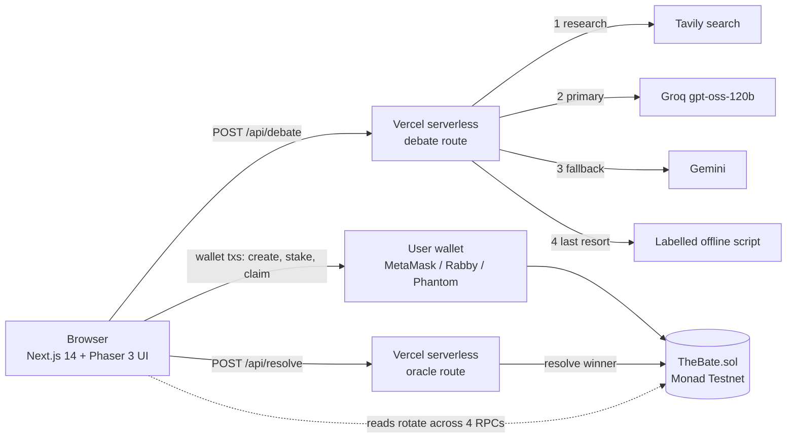
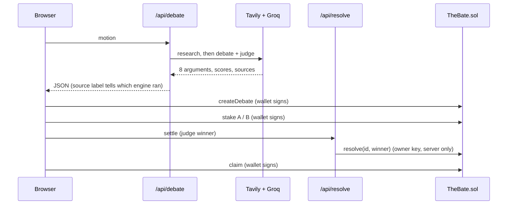
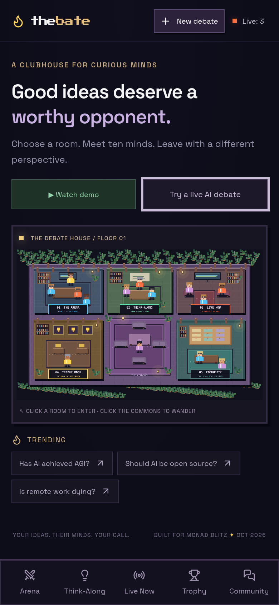

<div align="center">

# TheBate

**Ten AI minds debate. A judge picks a winner. You stake MON on the outcome.**

Live on Monad Testnet - built for Monad Blitz Pune V3

[**Live app**](https://the-bate.vercel.app) · [**Watch the demo**](https://the-bate.vercel.app/debate/demo?demo=1&topic=Has%20AI%20achieved%20AGI%3F) · [**Contract**](https://testnet.monadvision.com/address/0x6e06e99cc6f4bb56cc10927483d72667b5f0d20c) · [**Repo**](https://github.com/Mrun25/TheBate)

**Demo video (90s, narrated):** [docs/thebate-demo.mp4](docs/thebate-demo.mp4)


</div>

## At a glance

| | |
|---|---|
| Live URL | https://the-bate.vercel.app |
| One-click demo (no wallet, no keys) | https://the-bate.vercel.app/debate/demo?demo=1&topic=Has%20AI%20achieved%20AGI%3F |
| Network | Monad Testnet, chain ID `10143` |
| Contract | `0x6e06e99cc6f4bb56cc10927483d72667b5f0d20c` |
| Source | Full Solidity source in `contracts/`; explorer: [MonadVision](https://testnet.monadvision.com/address/0x6e06e99cc6f4bb56cc10927483d72667b5f0d20c) (verification status: check the explorer) |
| Deploy tx | `0xb967e75befca9ef84f189787cd87b944b16042d284cad39e885d52da4bdea1c7` |
| Hosting | Vercel Hobby (free, no card). Backend = Next.js API routes |
| AI | Gemini 3.5 Flash primary, Groq `gpt-oss-120b`/`20b` fallback (all free), Tavily web research (free) |
| Rules | Fresh code written on event day. No pre-existing project code |

## How it works

1. **Pick a motion.** The server researches it on the web (Tavily), then Groq writes an 8-argument, 3-round debate between Team A (for) and Team B (against) and judges it: scores, reasoning, strongest argument. Research links show under the verdict.
2. **Open a pool.** One click creates an on-chain pool for that debate (0.1 MON creation fee).
3. **Stake.** Anyone with a wallet stakes MON on Team A or Team B.
4. **Settle.** When the verdict lands, the judge oracle writes the winner on-chain.
5. **Claim.** Winners split the pot pro rata. 5% goes to the protocol. If nobody backed the winner, everyone is refunded.


## Team

Built at Monad Blitz Pune V3.

| Member | Work |
|---|---|
| **Mrunmayee Daware** | Next.js app and UX design, AI debate engine (Gemini and Groq chain, Tavily and arXiv research, per-statement sources), community feed, demo mode, deployment |
| **Hassan Rehman** | Solidity prediction-pool contract, on-chain integration (staking, settlement, claims), Monad testnet deployment and transaction testing |
| **Tanishq** | Team member |

## Architecture



### Request flow



## Fallbacks (nothing dead-ends)

| If this fails | The app does this |
|---|---|
| Tavily research fails | Debate runs without web sources; the verdict panel shows no research links |
| Gemini 3.5 Flash (primary) busy or error | Retries, then Gemini 3.1 Flash-Lite, then Groq `gpt-oss-120b`, then Groq `gpt-oss-20b` (all free tiers) |
| Every model fails | Clearly labelled offline script. The footer shows which engine ran |
| Viewer questions (`/api/ask`) | Tavily-grounded answer via Gemini, then Groq, then research snippets |
| Community feed (`/community`) | Vercel Blob store; if unreachable the page shows an empty state, debates still work |
| Watch demo (`/debate/demo?demo=1`) | Fully scripted, no API calls, so it works with every provider down |
| Tavily unavailable | Debate still runs, without research links |
| An RPC node is down | Reads rotate across 4 Monad Testnet RPCs with timeouts |
| No wallet in the browser | Pool stays readable, buttons explain what to do, MetaMask deep link and faucet link shown |
| Wallet rejects, low balance, slow network | Plain-language message, nothing breaks |
| Settlement service busy | Friendly retry message |
| Unexpected crash | App-level error page and 404 page |
| Visitor just wants to look | **Demo mode**: scripted sample debate, simulated pool, no wallet and no keys. Clearly labelled |

## Contract

`contracts/TheBate.sol`, about 120 lines, no dependencies.

| Function | Who | What |
|---|---|---|
| `createDebate(topic)` payable 0.1 MON | anyone | opens a pool, fee goes to the protocol |
| `stake(id, side)` payable | anyone | side 0 = Team A, 1 = Team B |
| `resolve(id, winner)` | owner (judge oracle) | closes staking, sets the winner |
| `claim(id)` | stakers | pays winners pro rata, refunds if voided |
| `withdrawFees()` | owner | pulls the 5% cut and creation fees |

**Honest limit:** the judge oracle is centralized. The contract owner writes the AI judge's winner on-chain, so you trust that key. A production version would use several judges or an optimistic dispute window.

### Proof of a full on-chain run (production UI, pool #12)

| Step | Tx |
|---|---|
| createDebate | [`0xd82f34ac...5064`](https://testnet.monadvision.com/tx/0xd82f34ac488e497326251c06958aeb81cf5b2930f0d12ed5e8fd9e2a22405064) |
| stake Team A | [`0x4e447d8b...8618`](https://testnet.monadvision.com/tx/0x4e447d8b571040045582cd1f2b97522183f4892e204db1fb6a41bf63c4b78618) |
| stake Team B | [`0xe1a90468...3961`](https://testnet.monadvision.com/tx/0xe1a9046860425c9c5cd9d893eb179ab52c4de799819de734caad1e84db843961) |
| resolve | [`0x3213be76...4f45`](https://testnet.monadvision.com/tx/0x3213be7652e7a091d3660552d50bf3cfabe73c44493e92ad460d4a9c88bd4f45) |
| claim | [`0x1e6691c5...321f`](https://testnet.monadvision.com/tx/0x1e6691c568fb4068f001c2e1b310600d8369a551dfd690414363a55cc1d1321f) |

## Project map

```
app/
  [[...slug]]/page.tsx     single-page shell for all routes
  api/debate/route.ts      Tavily research -> Gemini -> Groq -> offline fallback
  api/resolve/route.ts     server-side judge oracle (owner key from env)
  error.tsx, not-found.tsx graceful failure pages
  globals.css              all styling, mobile breakpoints
components/
  DebateApp.tsx            lobby, arena, verdict, vote, demo mode, sources
  World.tsx                Phaser pixel-art scenes
  ChainPanel.tsx           live pool (wallet) and simulated demo pool
lib/
  chain.ts                 viem clients, 4-RPC fallback, wallet connect
  abi.ts                   contract ABI (generated)
  bridge.ts, data.ts       UI event bus and sample data
contracts/TheBate.sol      the contract
scripts/                   compile, deploy, verify (Sourcify), e2e on-chain test
tests/                     UI and chain tests (Playwright)
deployment.json            deployed address and tx
```

## Run from a fresh clone

Needs Node 18.17+.

```sh
git clone https://github.com/Mrun25/TheBate && cd TheBate
npm ci
cp .env.example .env.local   # fill in the keys you have, all optional
npm run dev                  # http://localhost:3000
```

With no keys at all the app still works: debates use the labelled offline script and demo mode is fully functional.

| Env var | Use |
|---|---|
| `GROQ_API_KEY` | primary debate engine (Groq free tier) |
| `GEMINI_API_KEY` | optional second engine (Google AI Studio free key) |
| `TAVILY_API_KEY` | web research that grounds the debate (free tier) |
| `ORACLE_PRIVATE_KEY` | contract owner key, server only, used by `/api/resolve` |
| `NEXT_PUBLIC_THEBATE_ADDRESS` | contract address (defaults to the deployed one) |

To stake you need a browser wallet (MetaMask, Phantom, Rabby) with testnet MON from https://faucet.monad.xyz. The app adds and switches to Monad Testnet for you.

## Deploy

**Frontend + backend (free, no card):** import the repo on Vercel, framework Next.js, add the env vars above, deploy. The API routes are serverless functions, so there is no separate server to host.

**Contract (optional, already deployed and verified):**

```sh
npm run compile                          # solc -> artifacts/ and lib/abi.ts
DEPLOYER_PRIVATE_KEY=0x... npm run deploy
node scripts/verify.cjs                  # Sourcify verification
```

Use a fresh burner key funded from the faucet. Never commit keys: `.env*` and `.deployer.key` are gitignored.

Monad note: low-balance accounts hit a reserve-balance rule, so do not send two transactions from one account in the same block.

## Tests

```sh
node scripts/e2e.mjs                                                       # create, stake x2, resolve, claim on the live contract
DEPLOYER_KEY=0x... BASE=http://localhost:3000 node tests/chain-e2e.cjs     # drives the real UI with a signer
node tests/interactions.cjs                                                # UI interactions, routes, widths 320-1440
```

## Mobile



## Privacy and security

No secrets in the repo or its history. Keys live in Vercel env vars. The oracle key is only read server side.
