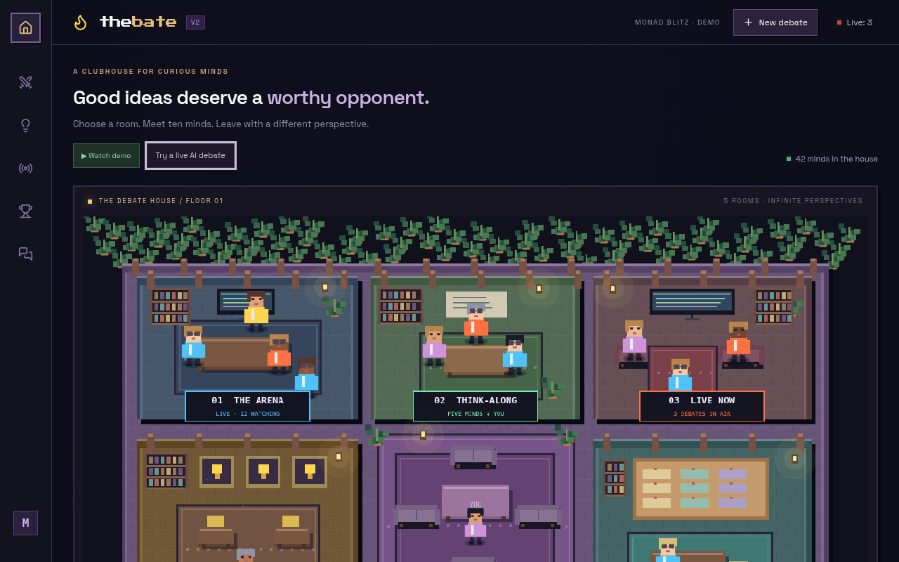
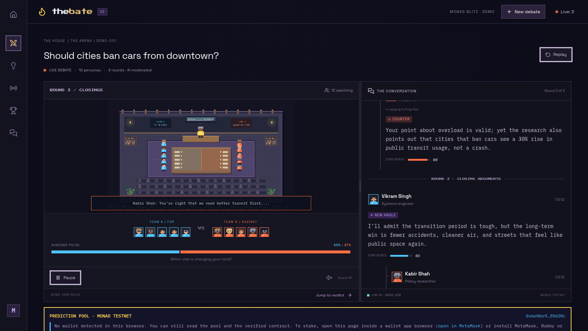
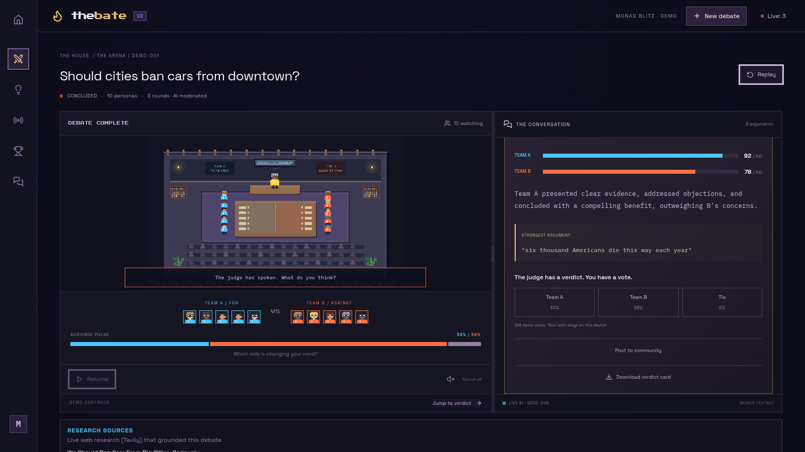
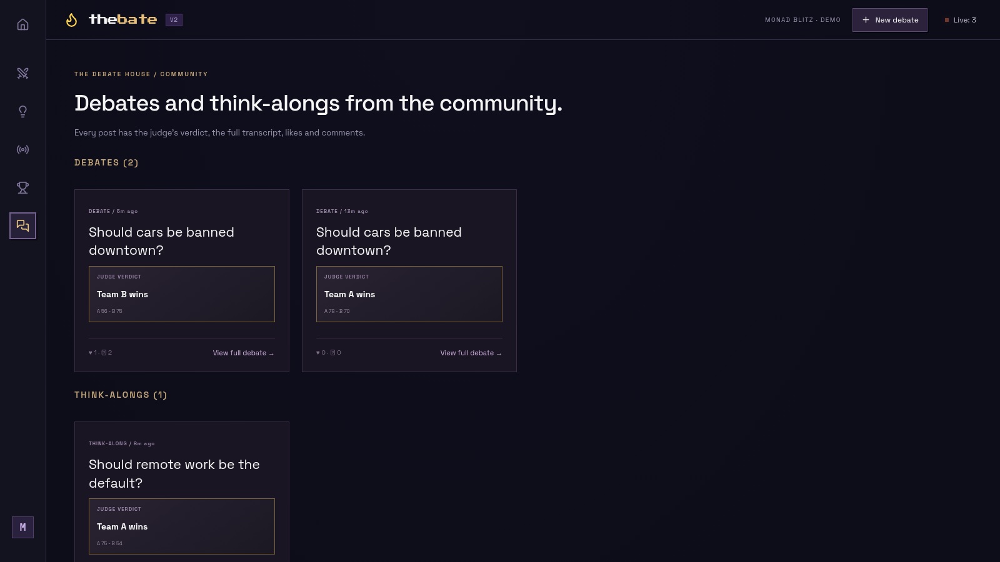
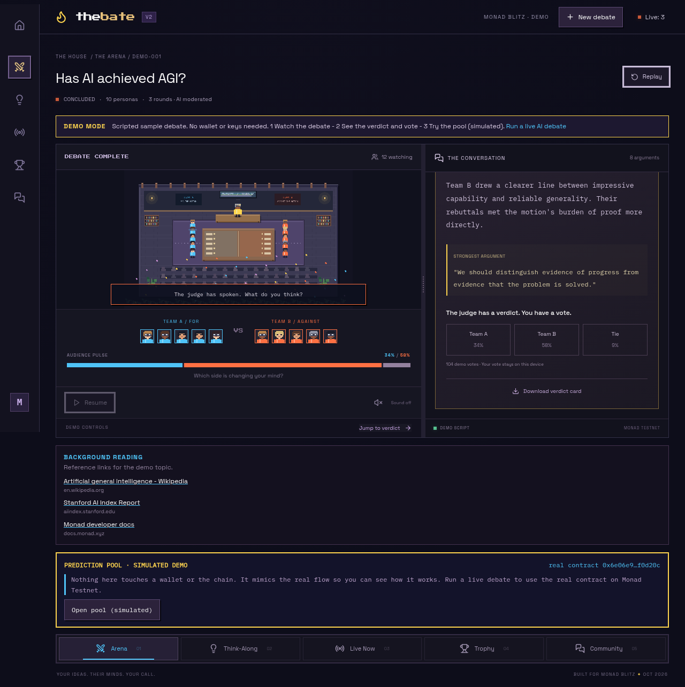
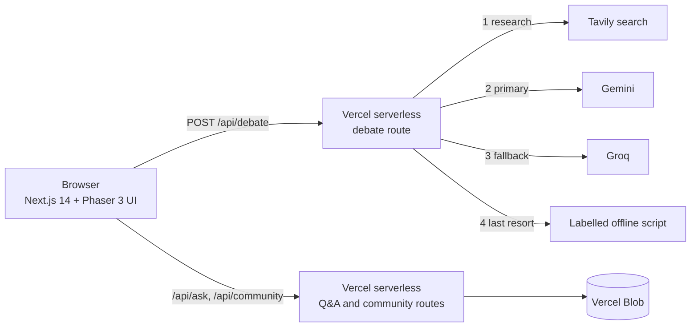

<div align="center">

# TheBate

**Ten AI minds debate. A judge picks a winner. You decide who convinced you.**

[**Live app**](https://the-bate.vercel.app) · [**Watch the demo**](https://the-bate.vercel.app/debate/demo?demo=1&topic=Has%20AI%20achieved%20AGI%3F) · [**Repo**](https://github.com/Mrun25/TheBate)

**Demo video (90s, narrated):** [docs/thebate-demo.mp4](docs/thebate-demo.mp4)



</div>

## The idea

Online arguments never end. There is no research, no structure and no verdict, so nobody changes their mind.

TheBate turns any hot take into a structured, researched debate run by AI agents. Ten personas split into two teams, argue over three rounds, and an AI judge scores the result, names the strongest argument and explains the verdict. You can vote, ask the panel questions, and post the debate to a community feed. It all runs in a browser with no install.

Hosting is Vercel Hobby (free). The backend is Next.js API routes.

## Features

| Feature | What it does |
|---|---|
| Arena debate | 10 personas in 2 teams argue a motion in 3 rounds, each answering the one before. Tone selectable: balanced, heated, academic, playful |
| Research grounding | Tavily web search plus arXiv papers feed the debate. Each statement shows a source link only when a real search result matches it. The model never writes URLs |
| AI judge | Scores both teams, names the strongest argument, explains the verdict |
| Think-Along | Join the table as a seat, ask the panel questions, get answers grounded in live research |
| Community | Post a finished debate or think-along, share a permalink, like and comment |
| Demo mode | A fully scripted debate that needs no API keys |





## What is real and what is not

| Real | Not (yet) |
|---|---|
| Live AI debates from Gemini or Groq, grounded in live search | The offline script and Watch demo are scripted and labelled as such |
| Research links come from real search results | A link means the source is related by keywords, not that it proves the claim |
| Free-tier AI keys can rate-limit under load | Fallbacks cover it, but a very busy moment can show the offline script (footer says which engine ran) |

## How it works

1. **Pick a motion.** The server researches it on the web (Tavily), then an AI model (Gemini, with Groq as fallback) writes an 8-argument, 3-round debate between Team A (for) and Team B (against) and judges it: scores, reasoning, strongest argument. Research links show under the verdict.
2. **Watch or jump ahead.** Statements stream in round by round in the pixel-art debate house, or you can jump straight to the verdict.
3. **Vote.** Back Team A, Team B or call it a tie. Your vote stays on your device.
4. **Share.** Post the debate to the community feed or download a verdict card.



## Architecture



## Fallbacks (nothing dead-ends)

| If this fails | The app does this |
|---|---|
| Tavily research fails | Debate runs without web sources; the verdict panel shows no research links |
| Gemini 3.5 Flash (primary) busy or error | Retries, then Gemini 3.1 Flash-Lite, then Groq `gpt-oss-120b`, then Groq `gpt-oss-20b` (all free tiers) |
| Every model fails | Clearly labelled offline script. The footer shows which engine ran |
| Viewer questions (`/api/ask`) | Tavily-grounded answer via Gemini, then Groq, then research snippets |
| Community feed (`/community`) | Vercel Blob store; if unreachable the page shows an empty state, debates still work |
| Watch demo (`/debate/demo?demo=1`) | Fully scripted, no API calls, so it works with every provider down |
| Unexpected crash | App-level error page and 404 page |

## Project map

```
app/
  [[...slug]]/page.tsx     single-page shell for all routes
  api/debate/route.ts      Tavily research -> Gemini -> Groq -> offline fallback
  api/ask/route.ts         viewer questions
  api/community/           community feed and permalinks
  error.tsx, not-found.tsx graceful failure pages
  globals.css              all styling, mobile breakpoints
components/
  DebateApp.tsx            lobby, arena, verdict, vote, demo mode, sources
  World.tsx                Phaser pixel-art scenes
  Community.tsx            community feed
lib/
  bridge.ts, data.ts       UI event bus and sample data
  offline.ts, store.ts     offline script and community store
tests/                     UI tests (Playwright)
```

## Run from a fresh clone

Needs Node 18.17+.

```sh
git clone https://github.com/Mrun25/TheBate && cd TheBate
npm ci
# optional: create .env.local with GROQ_API_KEY, GEMINI_API_KEY, TAVILY_API_KEY
npm run dev                  # http://localhost:3000
```

With no keys at all the app still works: debates use the labelled offline script and demo mode is fully functional.

| Env var | Use |
|---|---|
| `GROQ_API_KEY` | debate engine (Groq free tier) |
| `GEMINI_API_KEY` | debate engine (Google AI Studio free key) |
| `TAVILY_API_KEY` | web research that grounds the debate (free tier) |

## Deploy

Import the repo on Vercel, framework Next.js, add the env vars above, deploy. The API routes are serverless functions, so there is no separate server to host.

## Team

Built at Monad Blitz Pune V3.

| Member | Work |
|---|---|
| **Mrunmayee Daware** | Next.js app and UX design, AI debate engine (Gemini and Groq chain, Tavily and arXiv research, per-statement sources), community feed, demo mode, deployment |
| **Hassan Rehman** | Solidity prediction-pool contract and on-chain integration for the hackathon build |
| **Tanishq** | Team member |

The hackathon version had a Monad Testnet prediction pool. That code is kept on the `archive/monad-pools` branch and is no longer part of the app.

## Privacy and security

No secrets in the repo or its history. Keys live in Vercel env vars.

## License

MIT. See [LICENSE](LICENSE).
